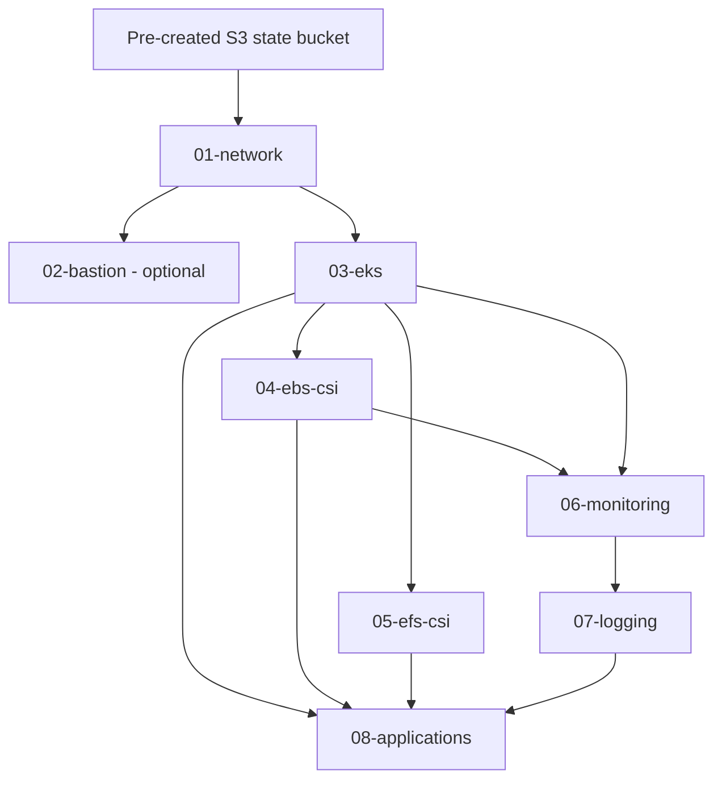

# AWS EKS platform architecture

## Design principles

The AWS implementation follows the same separation used by the GKE blueprint:

- Client/environment configuration is YAML-driven and kept outside reusable Terraform modules.
- Reusable modules own resource implementation; Terragrunt live units own environment wiring and dependencies.
- Each live component has an independent, stable S3 state key.
- Dependency outputs are consumed from upstream state. Mock outputs are permitted only for init/validate, never plan.
- Plan, apply, and destroy are separate operations. Saved plans are checksum- and commit-bound.
- Bootstrap state storage is external to the environment lifecycle and is never destroyed by destroy-env.
- Static tests are read-only and do not contact AWS or mutate infrastructure.

## Component flow



| Layer | Responsibility | Key outputs / dependency |
| --- | --- | --- |
| 01-network | Create or adopt VPC and subnets; NAT and VPC Flow Logs for a new VPC | VPC ID, private/public subnet IDs |
| 02-bastion | Optional EC2 administration host with SSM role and explicit ingress | Instance ID and private/public IP |
| 03-eks | EKS control plane, managed node groups, IRSA/OIDC, control-plane logging | Cluster name, endpoint, OIDC issuer/provider, node security group |
| 04-ebs-csi | EBS CSI add-on, IRSA, encrypted gp3 StorageClass; optional static PV/PVC for an existing volume | StorageClass and CSI role |
| 05-efs-csi | EFS CSI add-on, IRSA, optional encrypted EFS and mount targets, RWX StorageClass | File-system ID and StorageClass |
| 06-monitoring | kube-prometheus-stack Helm release | Monitoring namespace and Grafana service |
| 07-logging | Loki and Alloy Helm releases plus Grafana datasource/dashboard | Loki service URL |
| 08-applications | YAML-driven releases of the shared application Helm chart | Release names and namespaces |

## Repository layout

- 00-documentation: architecture, runbooks, backend and state migration guidance.
- 01-config: client/environment infrastructure, monitoring/logging overrides, and application values.
- 02-scripts: bootstrap, plan, apply, destroy, scaffolding, and templates.
- 03-modules: reusable Terraform modules.
- 04-live: Terragrunt root and client/environment component units.
- 05-helm-charts: shared generic application chart.
- 06-examples: storage smoke-test manifests.
- 07-tests: read-only static validation.

The former 01-bootstrap, 03-live, 12-platform-config, 13-kubernetes-apps, and 15-scripts directories are retained as legacy material. New automation uses 01-config, 02-scripts, 03-modules, 04-live, 05-helm-charts, 06-examples, and 07-tests only.

## State layout

The live root derives client and environment from the path and loads the matching YAML configuration. State keys are stable logical names rather than raw directory names:

```text
s3://<state-bucket>/aws-eks/<client>/<environment>/<logical-layer>/terraform.tfstate
```

Examples: network, eks, ebs-csi, efs-csi, monitoring, logging, applications. This avoids state-key changes when a folder is renamed. The S3 bucket is versioned, encrypted, public-access-blocked, and protected by a deny-insecure-transport policy when created by the bootstrap script. Terraform's S3 native lockfile is enabled.

## Security boundaries

- EKS API access is private by default. Operators and Terraform Helm/Kubernetes providers must run from a network that can reach the private endpoint (VPC runner, VPN, or equivalent).
- Public EKS API access requires a non-empty CIDR allowlist in the module contract.
- Bastion creation is disabled in the sample configuration; ingress defaults to an empty list. Prefer SSM Session Manager.
- If the optional bastion is enabled in the public subnet, its sample setting assigns a public IP so the SSM agent can reach AWS SSM public endpoints. No inbound security-group rules are opened by default. For a private-only bastion, provision and verify SSM interface endpoints before disabling its public IP.
- EBS/EFS controllers use IRSA with service-account-specific OIDC trust conditions.
- IMDSv2 is required on the bastion and its root volume is encrypted gp3.
- Plan files, manifests, and Terraform state can contain sensitive data. Plan directories are private and remain outside Git.
- The bootstrap bucket is deliberately excluded from destroy orchestration.

## Important implementation boundaries

This is a reusable foundation, not a claim that every optional AWS platform integration is installed. In particular, the current live layers do not provision ECR repositories/image lifecycle, Jenkins CI/CD, AWS Secrets Manager-to-External-Secrets integration, AWS Load Balancer Controller, Karpenter, or VPC interface endpoints. Application values that require those controllers must not be enabled until their prerequisites are installed and validated.

The committed Loki configuration is a single-replica filesystem-backed development setup. It is not an HA or long-term durable logging design. Production use requires a reviewed S3-backed Loki architecture, HA topology, alert routing, resource sizing, and retention policy.
